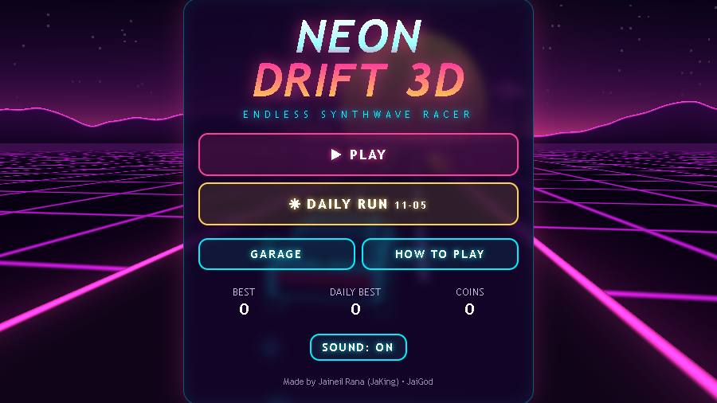
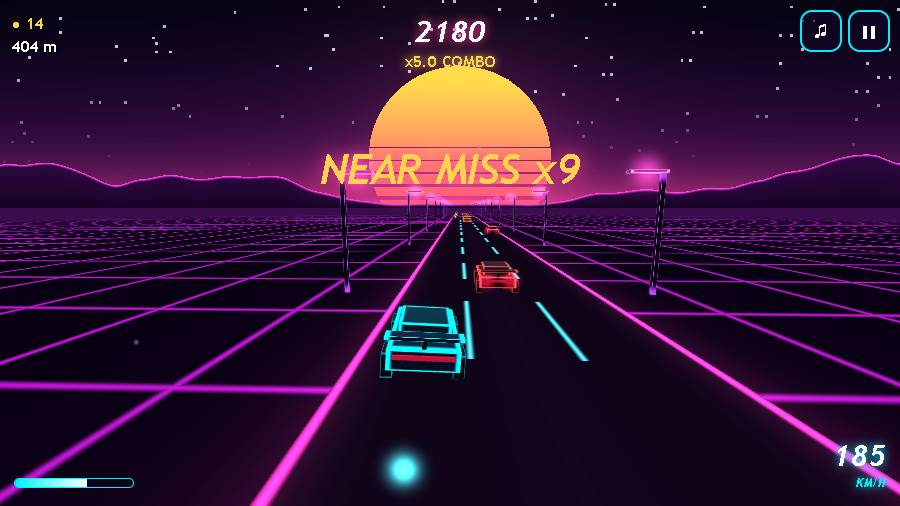
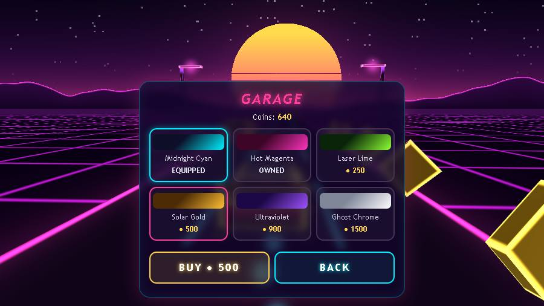
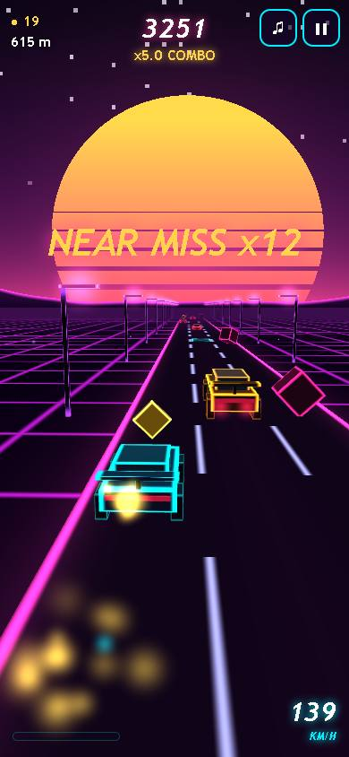

<div align="center">

# 🌆 NEON DRIFT 3D 🏎️

### An endless synthwave lane racer, rendered with a hand-written raw WebGL engine

[](https://jaigod.github.io/neon-drift-3d/)
[](https://github.com/JaiGod/neon-drift-3d/releases/latest)


**[▶ jaigod.github.io/neon-drift-3d](https://jaigod.github.io/neon-drift-3d/)**

</div>

---

## 🎮 About

Race down a glowing retro-future highway toward a striped synthwave sun. Drift between three lanes, slip past traffic for **near-miss** combos, hit **boost pads** to smash through cars, and grab **coins** to unlock new car colorways in the **garage**. Every day there is a new **Daily Run**: a seeded track that is the same for every player.

Everything you see and hear is generated in code: no images, no audio files, no 3D library, and no CDN. The whole game is a single `index.html`.

## 📸 Screenshots

<table>
  <tr>
    <td width="50%"></td>
    <td width="50%"></td>
  </tr>
  <tr>
    <td align="center"><b>Title screen</b> · live 3D menu behind the UI</td>
    <td align="center"><b>Gameplay</b> · boost + near-miss combo</td>
  </tr>
  <tr>
    <td width="50%"></td>
    <td width="50%" align="center"></td>
  </tr>
  <tr>
    <td align="center"><b>Garage</b> · 5 unlockable colorways</td>
    <td align="center"><b>Mobile</b> · swipe / tap controls (390×844)</td>
  </tr>
</table>

> Screenshots were captured from the real game running in the browser.

## ✨ Features

| | |
|---|---|
| 🛣️ **Raw WebGL renderer** | Custom matrix math, 4 shader programs, procedural neon grid, sky, sun and mountains |
| 🚗 **Drifting car** | Smooth eased lane changes with yaw and roll, underglow, and exhaust sparks |
| 🚚 **Traffic** | Sedans, long trucks and spinning glitch drones, always with a free lane |
| ⚡ **Boost pads** | 2.6 s speed burst with a wider FOV; you smash through traffic for +100 |
| 💥 **Near misses** | Pass a car in the next lane to build a combo multiplier, up to **x5** |
| 📈 **Speed ramp** | Starts at ~96 km/h and climbs to ~240 km/h (360 km/h while boosting) |
| 🪙 **Coins and garage** | 6 colorways: Midnight Cyan (free) plus **5 unlockables** from 100 to 1500 coins |
| 📅 **Daily seed run** | Seeded by today's date, with its own daily best |
| 🎵 **Synthwave soundtrack** | Kick, snare, hats, saw bass, arps, a pad and an echo, all synthesized live |
| 🔊 **SFX** | Coin blips, lane whoosh, near-miss swoosh, boost riser, smash and crash |
| ✨ **Juice** | Particles, screen shake, slow-motion crash, pop-in toasts and an animated UI |
| 💾 **Saves** | Best score, daily best, coins, owned cars and sound setting in `localStorage` |
| 📱 **Mobile ready** | Swipe or tap controls, safe-area aware HUD, no horizontal scroll at 390 px |
| 🛟 **Fallback** | A friendly message if WebGL is unavailable |

## 🔗 Links

| | |
|---|---|
| ▶️ **Play in browser** | [jaigod.github.io/neon-drift-3d](https://jaigod.github.io/neon-drift-3d/) |
| 📦 **Android APK** | [Latest release · NeonDrift3D.apk](https://github.com/JaiGod/neon-drift-3d/releases/latest) · [all releases](https://github.com/JaiGod/neon-drift-3d/releases) |
| 🧠 **Game source** | [`index.html`](index.html) (renderer, game logic, audio and UI) |
| ⚙️ **APK build workflow** | [`.github/workflows/android.yml`](.github/workflows/android.yml) · [Actions runs](https://github.com/JaiGod/neon-drift-3d/actions) |
| 🖼️ **Screenshots folder** | [`docs/screenshots/`](docs/screenshots) |
| 📄 **License** | [MIT](LICENSE) |
| 🏢 **JaiGod org** | [github.com/JaiGod](https://github.com/JaiGod) |

### 🎮 More JaiGod games

- 🪐 [**Orbit Sling**](https://github.com/JaiGod/orbit-sling): [▶ play](https://jaigod.github.io/orbit-sling/)
- 🔥 [**Ember Crypt**](https://github.com/JaiGod/ember-crypt)
- 🛡️ [**Bulwark TDS**](https://github.com/JaiGod/bulwark-tds)
- 🟢 [**Slimefall TD**](https://github.com/JaiGod/slimefall-td)
- 🥷 [**Stickman Shadow Wars**](https://github.com/JaiGod/stickman-shadow-wars)
- 🕯️ [**The Hollow Between**](https://github.com/JaiGod/the-hollow-between)
- 🚀 [**Nova Vanguard**](https://github.com/JaiGod/nova-vanguard)
- 🍩 [**Glaze & Grind**](https://github.com/JaiGod/glaze-and-grind)
- 👉 [See every project in the JaiGod org](https://github.com/orgs/JaiGod/repositories)

## 🕹️ Controls

| Action | Desktop | Phone |
|---|---|---|
| Change lane | `←` `→` or `A` `D` (or click left/right half) | Swipe, or tap the left/right side |
| Pause | `P` / `Esc` / ❚❚ button | ❚❚ button |
| Sound on/off | `M` / ♫ button | ♫ button |
| Start / retry | `Space` / `Enter` / `R` | Buttons |

## 🧰 Tech stack

- **HTML5 + CSS** for the overlay UI (title, garage, how-to-play, pause and game-over panels)
- **WebGL 1.0**, no Three.js: a hand-written `perspective` / `lookAt` / model matrix library
  - `bg` shader: sky gradient, twinkling stars, a striped sun and noise-generated mountains
  - `ground` shader: an infinite scrolling road and grid, computed per pixel from world coordinates
  - `mesh` shader: one unit cube drawn many times, with neon edge glow from the cube's local coordinates, rim light and fog
  - `points` shader: additive point sprites for particles, underglow, tail lights and lamp glow
- **WebAudio API** for a lookahead step sequencer and all sound effects
- **Capacitor 6 + GitHub Actions** to build the Android APK automatically

## 📁 Project structure

```
neon-drift-3d/
├── index.html                    # the entire game (renderer, game logic, audio, UI)
├── README.md
├── LICENSE                       # MIT
├── docs/screenshots/             # README screenshots (title, gameplay, garage, mobile)
└── .github/workflows/android.yml # Capacitor -> Gradle -> NeonDrift3D.apk on release v1.0.0
```

## 🚀 Run locally

```bash
git clone https://github.com/JaiGod/neon-drift-3d.git
cd neon-drift-3d
python3 -m http.server 8000
# open http://localhost:8000
```

You can also just double-click `index.html`, because it has no external requests.

### 📦 Android APK

Every push to `main` runs **Build Android APK**. It copies `index.html` into a Capacitor `www/` folder, generates the Android project (`io.github.jaigod.neondrift3d`), builds `assembleDebug` with Gradle and attaches **`NeonDrift3D.apk`** to the [`v1.0.0` release](https://github.com/JaiGod/neon-drift-3d/releases/latest).

## 📓 Development log

**Day 1: picking the look.** I wanted the classic 80s "outrun" vibe: a magenta grid, a sunset with horizontal stripes and a chrome logo. I gave myself a challenge: no Three.js. I wrote the renderer myself, with my own `persp()`, `lookAt()` and a model-matrix function that builds translate × rotateY × rotateX × rotateZ × scale in one go.

**The road is a shader, not geometry.** At first I planned to scroll lots of line meshes. Instead the ground is one giant quad, and the fragment shader draws the grid, lane dashes and glowing road edges from world-space `x/z` minus a scroll offset. Problem: the offset grows forever and float precision broke the dashes after a few minutes. Fix: wrap it with `offset % 28`, the least common multiple of the dash period (7) and the grid period (4).

**Neon edges with one cube.** Every object (cars, coins, lamps, drones) is the same unit cube. The edge glow comes from the "middle" component of `abs(localPos)`. When two axes are near ±0.5 you're on an edge, so it lights up. That gave the Tron-like wireframe look with no extra geometry.

**GLSL gotcha.** `mat3(mat4)` doesn't exist in GLSL ES 1.0, so normals are transformed as `(uM * vec4(n, 0.)).xyz`. I also learned that `smoothstep(a, b, x)` with `a > b` is undefined behavior in the spec, so I replaced it with `1. - smoothstep(...)`.

**Sky that matches the camera.** The sky is a full-screen triangle, but the horizon has to line up with the 3D ground. Each frame I project a point 1000 units ahead through the view-projection matrix and send its screen Y to the shader. The sun and mountains then sit exactly on the horizon, even as the camera sways in the menu.

**Fair traffic.** At first traffic moved at different speeds, so sometimes three cars lined up and blocked every lane. That's unfair. Now all hazards share one relative speed (70% of the road speed, so they look like they are driving), and each row blocks at most two lanes. Row spacing shrinks over time but never below 15 units.

**Near misses.** When a car's center crosses yours, I check its sideways distance. Close but not touching counts as a near miss, which adds to the combo and resets a 3-second timer. Chaining them raises the multiplier to x5, so playing riskier pays off.

**Making a soundtrack from nothing.** The music is a 16-step sequencer at 104 BPM. It uses a lookahead scheduler (`setInterval` that queues notes about 150 ms ahead on the audio clock) so the timing doesn't drift. It plays an Am, F, C, G progression with a filtered saw bass, a square arpeggio, a detuned saw pad and a triangle echo. In the menu the drums are quieter and the snare drops out, then it kicks in when you start a run.

**Mobile.** I tested at 390×844 with Playwright. On tall screens the camera pulls back and widens the FOV so you can still see the traffic coming. Touch handles both swipes (28 px threshold) and quick taps on either side of the screen, and `touch-action: none` stops the page from scrolling.

**Testing headless WebGL.** I ran Chromium with SwiftShader (`--use-gl=swiftshader`) so I could take screenshots and play through runs in code: start, steer, boost, crash and retry, with zero console errors.

## 🗺️ Ideas for later

- Online daily leaderboard
- Curved roads and hills
- More hazard types (lane-switching bikes, laser gates)

---

<div align="center">

Made by Jaineil Rana (JaKing) · part of [JaiGod](https://github.com/JaiGod)

</div>
